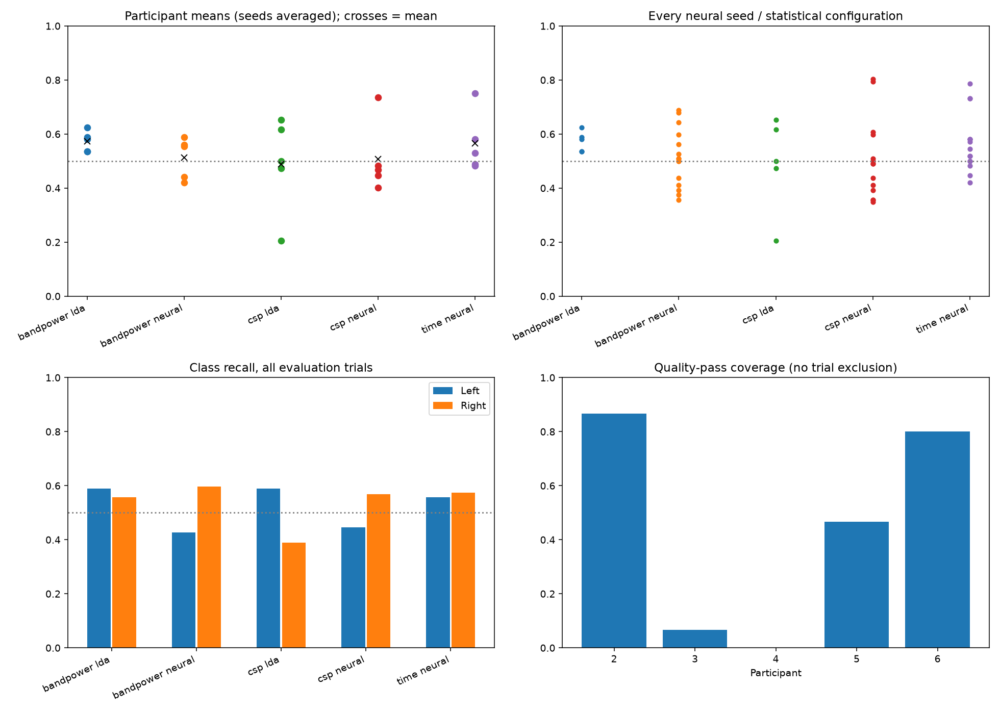

# Neural Decoding for Embodied Robotics

I built a decoder that turns simulated neural signals into rest, left, and right commands, then connected it to Pollen Robotics’ existing Microduck simulation. In a separate experiment, I compared decoders on prerecorded human EEG from PhysioNet.

**Status:** synthetic signal-to-robot simulation is implemented; recorded human EEG analysis is exploratory. Reliable live human brain control has not been demonstrated.

## Research contributions

- Simulate 96 neural units observed through 24 virtual electrode channels; decode rest, left, and right intentions.
- Connect decoded commands to the upstream Microduck locomotion policy in MuJoCo, with confidence gating, command expiry, and replay timing checks.
- Compare statistical decoders and neural networks; test noise, electrode shifts, gain reduction, channel loss, and adaptation.
- Evaluate LDA, CNN, MLP, and CSP-based approaches on prerecorded PhysioNet motor-imagery EEG, including participant-level analyses and calibration experiments.
- Preserve trained models, evaluation artifacts, protocols, tests, and reproducible report generation.

This project adds neural decoding and evaluation to Pollen Robotics’ robot design, simulation assets, and pretrained locomotion policy.

## Selected findings

| Experiment | Saved result | Interpretation |
|---|---|---|
| Synthetic rest/left/right neural models | 97.00–98.44% balanced accuracy across three initializations | Simplified simulated signals; not human EEG performance |
| Frozen controllers, sudden gain reduction | Target acquisition fell from 29/36 to 14/36 | Recording changes can undermine downstream control |
| Added noise during synthetic rest | 11 unwanted movement events versus 0 undisturbed | Classification accuracy alone does not establish safe control |
| Human EEG, five previously inspected participants | Band-power LDA 57.32%; time CNN 56.61% mean balanced accuracy | Exploratory binary imagery classification; no confirmed winning model |
| Personal calibration, eight previously inspected participants | Mean change −0.89 percentage points at 12 trials / 50 updates | Uncertainty includes zero; calibration did not consistently help |

Evidence: [synthetic models](docs/neural-network-report.md), [robustness](docs/robustness-report.md), [EEG features](docs/feature-benchmark-report.md), [calibration](docs/calibration-report.md), and [completion evidence](docs/eeg-completion-report.md).



## Repository guide

- `src/neuralduck/`: simulation adapter, signal generation, decoding, preprocessing, experiments, and reports.
- `tests/`: contracts, leakage boundaries, replay scoring, inference integrity, and report tests.
- `docs/`: research protocols and chronological findings, including negative results.
- `artifacts/`: saved metrics, model checkpoints, predictions, traces, and figures.
- `models/`: baseline decoders and the upstream locomotion policy, with provenance.

## Setup and reproduction

Python 3.12 was used for the local environment. From the repository root:

```powershell
python -m venv .venv
.\.venv\Scripts\python.exe -m pip install -r requirements.txt
.\.venv\Scripts\python.exe -m pip install -r requirements-neural-network.txt
$env:PYTHONPATH = 'src'
.\.venv\Scripts\python.exe -m neuralduck.completion_report
```

Open `artifacts/consolidated-report/report.html` to inspect the regenerated EEG report. This command uses saved outputs without training or downloading recordings. On Linux/macOS, use `.venv/bin/python` and `export PYTHONPATH=src`.

For robot simulation and tests that use its assets, clone the pinned upstream repository as a sibling:

```powershell
git clone https://github.com/pollen-robotics/microduck_rl.git ../microduck-rl-research
git -C ../microduck-rl-research checkout b02fdea4902c2b93b7d34a83a6f05da4ececb7d3
.\.venv\Scripts\python.exe -m unittest discover -s tests -v
.\.venv\Scripts\python.exe -m neuralduck.demo --seconds 10 --no-frame
```

`Open-Neural-Network-Duck.cmd` launches saved synthetic neural replay after setup. Fresh dependency installation has not been independently validated for this publication; the recorded lock file documents the existing environment.

Raw PhysioNet EDF recordings and preprocessing caches are excluded. Source-recording verification requires downloading the dataset under its terms and restoring the recorded source paths or deliberately rebuilding the experiment manifests. Historical JSON manifests retain original local paths because their exact bytes and hashes bind the saved inference contracts. Do not edit them silently. Only load model files from a trusted source; pickle/joblib-based formats can execute code.

## Limitations

The synthetic electrode model mixes simulated neural activity and noise; it does not solve a physical scalp-voltage or tissue-conductivity model. Synthetic accuracy cannot be extrapolated to human EEG. Participants 1–22 have already been inspected, so future confirmation needs a locked evaluation protocol. Human rest detection, live EEG-to-robot control, whole-brain emulation, and clinical use remain unestablished. Some historical reports link to local logs or UI screenshots excluded from this publication.


